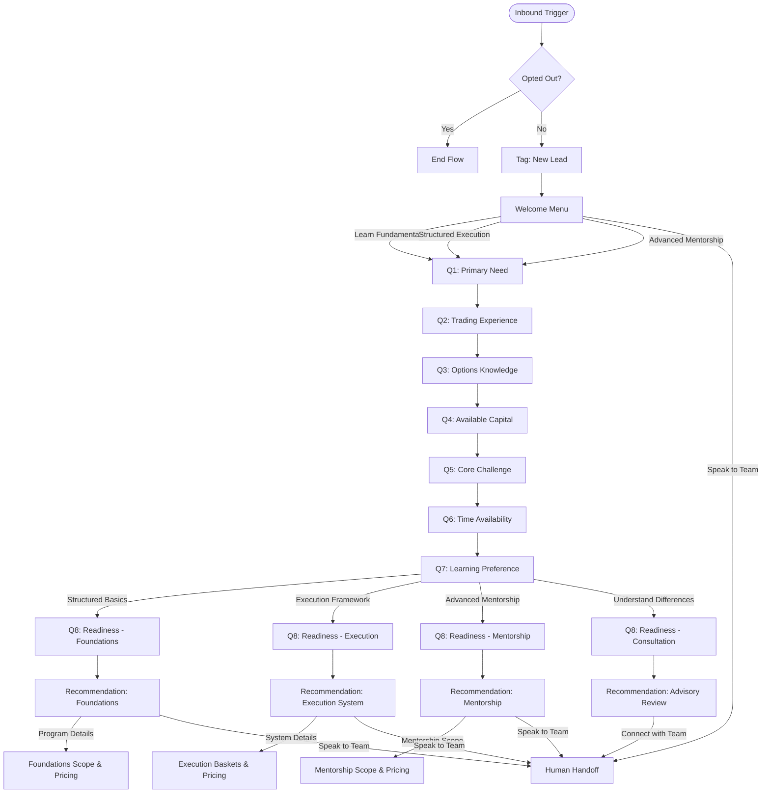

# Replete Equities — WhatsApp Lead Qualification & Product Positioning Flow V1
**Comprehensive Audit & Team Operational Blueprint**

---

## 1. Executive Summary

The **Replete Equities WhatsApp Lead Qualification & Product Positioning Flow V1** is an automated, 8-step conversational qualification engine running natively on WACRM. It deterministically assesses a prospect's market experience, capital allocation, knowledge level, and trading challenges to route them to the most suitable education or execution solution, score their purchase intent (out of 100 points), and synchronize data with the CRM sales pipeline.

```
                              [ Incoming Message ]
                                       │
                      Trigger: Keyword Match ("hi", "start"...)
                                       │
                              [ Check Opt-Out ]
                                 /          \
                       (Opted Out)          (Active)
                            │                   │
                   [ Suppress Flow ]    [ Tag: New Lead ]
                                                │
                                    [ Welcome List Menu ]
                                                │
                                 [ 8-Step Qualification ]
                               (Q1 Need → Q2 Exp → Q3 Know
                                → Q4 Cap → Q5 Chal → Q6 Time
                                → Q7 Preference → Q8 Readiness)
                                                │
                                   [ Scoring & Evaluation ]
                                  (100-Point Model + Rules)
                                                │
            ┌─────────────────────┬─────────────┴─────────────┬─────────────────────┐
            │                     │                           │                     │
      [ Foundations ]    [ Execution System ]           [ Mentorship ]        [ Human Review ]
         (₹14,999)      (₹9,999–₹29,999)                  (₹79,999)         (Advisory Handoff)
```

---

## 2. Flow Metadata & Trigger Engine

| Parameter | Configuration Value | Description |
| :--- | :--- | :--- |
| **Flow Name** | `Replete Equities — WhatsApp Lead Qualification & Product Positioning V1` | Production flow identifier |
| **Flow ID** | `b23a968f-6fbb-4d57-b016-538d58a5f8e6` | Database UUID |
| **Status** | `ACTIVE` | Currently live on `+91 72299 45555` |
| **Trigger Type** | `keyword` (Exact / Word Match) | Triggers on first word match |
| **Trigger Keywords** | `hi`, `hello`, `hey`, `start`, `replete`, `products`, `join`, `learn`, `trading` | Case-insensitive entry phrases |
| **Negative Keywords** | `support`, `payment`, `refund`, `invoice`, `bill`, `billing`, `receipt`, `chargeback`, `cancel`, `desk`, `helpdesk` | Prevents customer support inquiries from being hijacked |
| **Fallback Policy** | Reprompts: Max 2 attempts. On exhaust: auto-handoff to human desk. Timeout: 24h. | Resilient conversation recovery |
| **Total Graph Nodes** | 45 Nodes | Interactive Lists, Buttons, Tags, Conditions, Handoffs |

---

## 3. Visual Flow Architecture



---

## 4. Step-by-Step Message Blueprint

### Step 0: Opt-Out & Contact Tagging
* **Node `start`** (`start`) $\rightarrow$ Advances to `check_opt_out`.
* **Node `check_opt_out`** (`condition`):
  * **Condition**: Does contact have tag `OPT_OUT` (`acd6be77-b9dc-47bd-a025-aaf8bb065631`)?
  * **If True**: Routes to `flow_suppressed_opt_out` (terminates silently).
  * **If False**: Routes to `tag_new_lead`.
* **Node `tag_new_lead`** (`set_tag`): Adds `NEW_LEAD` tag (`1b8b87b2-8892-4c35-8305-917733883aa1`) and advances to `welcome_prompt`.

---

### Step 1: Welcome & Initial Path Selection
* **Node `welcome_prompt`** (`send_list`):
  * **Message Copy**:
    > "Hi {{vars.first_name}}! Welcome to Replete Equities.
    >
    > I'm here to help you identify which of our trading education and execution solutions best fits your current experience, requirements, and available capital.
    >
    > I'll ask a few quick questions so we can guide you towards the right option. There is no obligation to purchase.
    >
    > Let's start!"
  * **Button Label**: `Choose Starting Path`
  * **List Options**:
    1. **Learn Fundamentals** (`wel_fundamentals`) — *"Learn trading & options basics"* $\rightarrow$ `ask_q1_primary_need`
    2. **Structured Execution** (`wel_execution`) — *"Rules-based execution system"* $\rightarrow$ `ask_q1_primary_need`
    3. **Advanced Mentorship** (`wel_mentorship`) — *"Option strategies & hedging"* $\rightarrow$ `ask_q1_primary_need`
    4. **Speak to the Team** (`wel_team`) — *"Connect with our advisory desk"* $\rightarrow$ `route_human_handoff`

---

### Step 2: The 8 Diagnostic Questions

#### Question 1/8: Primary Requirement
* **Node `ask_q1_primary_need`** (`send_list`):
  * **Message Copy**:
    > "Question 1/8: Primary Requirement
    >
    > What are you primarily looking for right now?"
  * **Button Label**: `Select Option`
  * **List Options**:
    * `Options Basics` (`pneed_basics`) — *"Build core option fundamentals"* $\rightarrow$ `ask_q2_trading_experience`
    * `Improve Process` (`pneed_process`) — *"Refine strategy & trade management"* $\rightarrow$ `ask_q2_trading_experience`
    * `Execution Framework` (`pneed_execution`) — *"Rules-based system to trade discipline"* $\rightarrow$ `ask_q2_trading_experience`
    * `Advanced & Hedging` (`pneed_advanced`) — *"Master portfolio Greeks & adjustment"* $\rightarrow$ `ask_q2_trading_experience`
    * `Explore Programs` (`pneed_explore`) — *"Understand which program fits best"* $\rightarrow$ `ask_q2_trading_experience`

#### Question 2/8: Trading Experience
* **Node `ask_q2_trading_experience`** (`send_list`):
  * **Message Copy**:
    > "Question 2/8: Trading Experience
    >
    > How long have you been trading the stock market or derivatives?"
  * **Button Label**: `Select Experience`
  * **List Options**:
    * `Beginner` (`exp_beginner`) — *"No prior trading experience"* $\rightarrow$ `ask_q3_options_knowledge`
    * `Less than 1 year` (`exp_lt_1yr`) — *"Learning market basics"* $\rightarrow$ `ask_q3_options_knowledge`
    * `1–3 years` (`exp_1_3yr`) — *"Active retail market participant"* $\rightarrow$ `ask_q3_options_knowledge`
    * `3–5 years` (`exp_3_5yr`) — *"Experienced with market cycles"* $\rightarrow$ `ask_q3_options_knowledge`
    * `More than 5 years` (`exp_gt_5yr`) — *"Seasoned market participant"* $\rightarrow$ `ask_q3_options_knowledge`

#### Question 3/8: Options Knowledge
* **Node `ask_q3_options_knowledge`** (`send_list`):
  * **Message Copy**:
    > "Question 3/8: Options Knowledge
    >
    > How comfortable are you with options, strike selection, Greeks, and risk management?"
  * **Button Label**: `Select Knowledge`
  * **List Options**:
    * `Complete beginner` (`know_beginner`) — *"Need to start from absolute basics"* $\rightarrow$ `ask_q4_trading_capital_band`
    * `Understand basics` (`know_basics`) — *"Know calls/puts, need structure"* $\rightarrow$ `ask_q4_trading_capital_band`
    * `Traded independently` (`know_independent`) — *"Trade spreads, straddles, iron condors"* $\rightarrow$ `ask_q4_trading_capital_band`
    * `Experienced in Hedging` (`know_experienced`) — *"Comfortable with Greeks and adjustments"* $\rightarrow$ `ask_q4_trading_capital_band`

#### Question 4/8: Available Capital
* **Node `ask_q4_trading_capital_band`** (`send_list`):
  * **Message Copy**:
    > "Question 4/8: Available Capital
    >
    > What approximate capital have you allocated, or are you planning to deploy, for options trading?
    >
    > *(This helps ensure our execution guidelines align with margin safety standards.)*"
  * **Button Label**: `Select Capital Band`
  * **List Options**:
    * `Below ₹50,000` (`cap_below_50k`) $\rightarrow$ `ask_q5_primary_challenge`
    * `₹50,000–₹1 lakh` (`cap_50k_1l`) $\rightarrow$ `ask_q5_primary_challenge`
    * `₹1–3 lakh` (`cap_1_3l`) $\rightarrow$ `ask_q5_primary_challenge`
    * `₹3–5 lakh` (`cap_3_5l`) $\rightarrow$ `ask_q5_primary_challenge`
    * `₹5–10 lakh` (`cap_5_10l`) $\rightarrow$ `ask_q5_primary_challenge`
    * `Above ₹10 lakh` (`cap_above_10l`) $\rightarrow$ `ask_q5_primary_challenge`
    * `Prefer not to say` (`cap_undisclosed`) $\rightarrow$ `ask_q5_primary_challenge`

#### Question 5/8: Main Challenge
* **Node `ask_q5_primary_challenge`** (`send_list`):
  * **Message Copy**:
    > "Question 5/8: Main Challenge
    >
    > What is your biggest challenge at the moment?"
  * **Button Label**: `Select Challenge`
  * **List Options**:
    * `Fundamentals` (`chal_fundamentals`) — *"Confused by Greeks & option chain"* $\rightarrow$ `ask_q6_time_availability`
    * `Managing Strategies` (`chal_strategies`) — *"Unsure when to enter or exit"* $\rightarrow$ `ask_q6_time_availability`
    * `Rules & Consistency` (`chal_consistency`) — *"Frequent strategy hopping"* $\rightarrow$ `ask_q6_time_availability`
    * `Execution Discipline` (`chal_discipline`) — *"Emotions impacting execution"* $\rightarrow$ `ask_q6_time_availability`
    * `Complex Hedges` (`chal_hedges`) — *"Struggling with live adjustments"* $\rightarrow$ `ask_q6_time_availability`
    * `Lack of Time` (`chal_time`) — *"Cannot monitor screen constantly"* $\rightarrow$ `ask_q6_time_availability`
    * `Not Sure Yet` (`chal_unsure`) — *"Looking for general guidance"* $\rightarrow$ `ask_q6_time_availability`

#### Question 6/8: Time Availability
* **Node `ask_q6_time_availability`** (`send_list`):
  * **Message Copy**:
    > "Question 6/8: Time Availability
    >
    > How much time can you realistically devote to trading and monitoring positions during market hours?"
  * **Button Label**: `Select Screen Time`
  * **List Options**:
    * `< 30 mins a day` (`time_lt_30m`) — *"Need automated / passive execution"* $\rightarrow$ `ask_q7_support_preference`
    * `30–60 mins a day` (`time_30_60m`) — *"Can execute and check at milestones"* $\rightarrow$ `ask_q7_support_preference`
    * `1–2 hours a day` (`time_1_2h`) — *"Active intraday monitoring"* $\rightarrow$ `ask_q7_support_preference`
    * `> 2 hours a day` (`time_gt_2h`) — *"Full market hours attention"* $\rightarrow$ `ask_q7_support_preference`
    * `Structured Schedule` (`time_structured`) — *"Dedicated morning/closing routine"* $\rightarrow$ `ask_q7_support_preference`

#### Question 7/8: Learning Preference
* **Node `ask_q7_support_preference`** (`send_list`):
  * **Message Copy**:
    > "Question 7/8: Learning Preference
    >
    > Which kind of support would be most useful to you?"
  * **Button Label**: `Select Preference`
  * **List Options**:
    * `Structured Basics` (`supp_basics`) — *"Foundations curriculum & fundamentals"* $\rightarrow$ `branch_foundations_q8`
    * `Execution Framework` (`supp_execution`) — *"Systematic rules-based trading tools"* $\rightarrow$ `branch_execution_q8`
    * `Advanced Mentorship` (`supp_mentorship`) — *"Personalized strategy & adjustments"* $\rightarrow$ `branch_mentorship_q8`
    * `Understand Differences` (`supp_unsure`) — *"Need human guidance to choose"* $\rightarrow$ `branch_unsure_q8`

#### Question 8/8: Purchase Readiness (Tailored per Branch)

| Branch Target | Node Key | Prompt Copy | Options & Timelines |
| :--- | :--- | :--- | :--- |
| **Foundations** | `branch_foundations_q8` | *"When would you ideally like to get started with your options foundation journey?"* | • Ready now (`ready_now_fnd`)<br>• Within 7 days (`ready_7d_fnd`)<br>• Within 30 days (`ready_30d_fnd`)<br>• Just researching (`ready_research_fnd`) |
| **Execution System** | `branch_execution_q8` | *"When would you ideally like to deploy a structured execution system?"* | • Ready now (`ready_now_exe`)<br>• Within 7 days (`ready_7d_exe`)<br>• Within 30 days (`ready_30d_exe`)<br>• Just researching (`ready_research_exe`) |
| **Mentorship** | `branch_mentorship_q8` | *"When would you ideally like to enroll in the Option Strategies Mentorship Program?"* | • Ready now (`ready_now_mnt`)<br>• Within 7 days (`ready_7d_mnt`)<br>• Within 30 days (`ready_30d_mnt`)<br>• Just researching (`ready_research_mnt`) |
| **Advisory Review** | `branch_unsure_q8` | *"When would you like to speak with our advisory team to clarify the differences?"* | • Ready now (`ready_now_rev`)<br>• Within 7 days (`ready_7d_rev`)<br>• Just researching (`ready_research_rev`) |

---

## 5. 100-Point Deterministic Lead Scoring Model

The qualification engine computes a deterministic score (0–100) based on five weighted dimensions:

$$\text{Lead Score} = \text{Need} (30) + \text{Experience} (20) + \text{Clarity} (15) + \text{Readiness} (20) + \text{Engagement} (15)$$

```
┌────────────────────────────────────────────────────────────────────────┐
│                        100-POINT SCORING MODEL                         │
├──────────────────────────┬───────────┬─────────────────────────────────┤
│ Dimension                │ Max Points│ Scoring Criteria                │
├──────────────────────────┼───────────┼─────────────────────────────────┤
│ 1. Need & Product Match  │    30     │ 30: Basics, Execution, Advanced │
│                          │           │ 20: Improve Process             │
│                          │           │ 10: General Exploration         │
├──────────────────────────┼───────────┼─────────────────────────────────┤
│ 2. Trading Experience    │    20     │ 20: 1–3 years or 3–5 years      │
│                          │           │ 15: > 5 years (seasoned)        │
│                          │           │ 10: < 1 year                    │
│                          │           │  5: Beginner (no experience)    │
├──────────────────────────┼───────────┼─────────────────────────────────┤
│ 3. Challenge Clarity     │    15     │ 15: Hedges, Discipline, Time    │
│                          │           │ 10: Strategies, Fundamentals    │
│                          │           │  5: Not sure / vague            │
├──────────────────────────┼───────────┼─────────────────────────────────┤
│ 4. Purchase Readiness    │    20     │ 20: Ready now                   │
│                          │           │ 15: Within 7 days               │
│                          │           │ 10: Within 30 days              │
│                          │           │  5: Just researching            │
├──────────────────────────┼───────────┼─────────────────────────────────┤
│ 5. Engagement Quality    │    15     │ 15: Completed with 0 reprompts  │
│                          │           │ 10: Completed with 1 reprompt   │
│                          │           │  5: Required 2+ reprompts       │
└──────────────────────────┴───────────┴─────────────────────────────────┘
```

### Score Intent Bands:
* **High Intent ($80 - 100$)**: Priority routing to senior sales desk. Candidate is ready to enroll.
* **Qualified ($50 - 79$)**: Standard nurturing and sales follow-up within 24 hours.
* **Researching ($< 50$)**: Automated educational nurture; no immediate high-pressure outbound.

---

## 6. Product Recommendations & Delivery Copy

### A. Replete Equities — Foundations
* **Investment**: ₹14,999 (One-time)
* **Target Audience**: Beginners, $< 1$ year experience, or traders needing fundamental Greeks and risk rules.
* **Recommendation Message** (`recommendation_foundations`):
  > "Thanks for sharing your background!
  >
  > **Our suggested next step: Foundations**
  >
  > Why this may fit:
  > You are looking to build a structured, solid grounding in options trading, strike selection, Greeks, and essential risk management before scaling up.
  >
  > Investment: ₹14,999
  >
  > *Note: This recommendation is based on your stated learning needs. It is not a promise of trading profits or a guarantee of suitability for every financial situation.*"
* **Action Buttons**:
  1. `Program Details` $\rightarrow$ Delivers syllabus highlights (`fnd_details_message`).
  2. `Speak to Team` $\rightarrow$ Triggers human desk notification (`route_human_handoff`).
  3. `Explore More` $\rightarrow$ Shows directory of all programs (`explore_other_options`).

---

### B. Execution System — Intraday Option Selling Basket
* **Pricing Plans**:
  * 3 Months: ₹9,999
  * 6 Months: ₹19,999
  * 12 Months: ₹29,999
* **Target Audience**: Intermediate traders ($\ge 1\text{--}3$ yrs) with capital $\ge ₹1\text{ Lakh}$ seeking a rules-based, emotion-free framework.
* **Recommendation Message** (`recommendation_execution`):
  > "Thanks for sharing your background!
  >
  > **Our suggested next step: Execution System — Intraday Option Selling Basket**
  >
  > Why this may fit:
  > You understand options fundamentals and want a disciplined, rules-based intraday framework to eliminate emotional errors and manage risk systematically.
  >
  > Pricing Options:
  > • 3 Months: ₹9,999
  > • 6 Months: ₹19,999
  > • 12 Months: ₹29,999
  >
  > *Note: Execution tools provide systematic discipline but do not eliminate market risk or guarantee trading profits. Please review risk disclosures prior to deployment.*"
* **Action Buttons**:
  1. `System Details` $\rightarrow$ Delivers pricing tiers & risk controls (`exe_details_message`).
  2. `Speak to Team` $\rightarrow$ Triggers human desk notification (`route_human_handoff`).
  3. `Explore More` $\rightarrow$ Shows directory of all programs (`explore_other_options`).

---

### C. Option Strategies Mentorship Program
* **Investment**: ₹79,999 (Comprehensive)
* **Target Audience**: Advanced participants with $\ge 1\text{--}3$ years screen time seeking mastery in volatility, dynamic hedging, and live market portfolio adjustments.
* **Recommendation Message** (`recommendation_mentorship`):
  > "Thanks for sharing your background!
  >
  > **Our suggested next step: Option Strategies Mentorship Program**
  >
  > Why this may fit:
  > You have active market experience and seek in-depth mastery in advanced non-directional strategies, dynamic adjustments, portfolio hedging, and risk architecture.
  >
  > Investment: ₹79,999
  >
  > *Note: This program focuses on advanced decision-making and risk modelling. It requires dedication and screen time commitment. Past performance does not guarantee future results.*"
* **Action Buttons**:
  1. `Mentorship Scope` $\rightarrow$ Delivers curriculum scope (`mnt_details_message`).
  2. `Speak to Team` $\rightarrow$ Triggers human desk notification (`route_human_handoff`).
  3. `Explore More` $\rightarrow$ Shows directory of all programs (`explore_other_options`).

---

### D. Human Advisory Review
* **Trigger Condition**:
  * Prospect clicked "Speak to the Team" or selected "Understand Differences".
  * Contradictory answers detected (e.g. Beginner claiming advanced hedging experience, or Mentorship requested with $< 30$ mins/day).
  * Capital mismatch (Execution System requested with $< ₹1\text{ Lakh}$).
* **Recommendation Message** (`recommendation_unsure_review`):
  > "Thanks for taking the time to share your preferences!
  >
  > Because your goals involve exploring the best fit across education and execution frameworks, we want to ensure you get personalized clarity rather than a generalized recommendation.
  >
  > We would be happy to have our Replete Equities advisory desk connect with you for a brief walkthrough."
* **Action Buttons**:
  1. `Connect with Team` $\rightarrow$ Routes to `route_human_handoff`.
  2. `Decide Later` $\rightarrow$ Polite closing message (`decide_later_message`).

---

## 7. Guardrails & Compliance Rules

The flow enforces mandatory risk guardrails:

> [!IMPORTANT]
> **1. Capital Barrier for Execution**: Intraday option selling requires minimum exchange margins. If a prospect indicates capital $< ₹1\text{ Lakh}$, the engine strictly overrides any execution recommendation and routes them to Human Review / Foundations to protect them from margin shortfall penalties.

> [!WARNING]
> **2. Beginner Protection from Mentorship**: Even if a beginner possesses capital $> ₹10\text{ Lakh}$ and requests Mentorship, the system **refuses** to enroll them directly in the ₹79,999 program. Foundational options mastery is mandatory first.

> [!NOTE]
> **3. Contradiction Detection**: If a participant selects "Beginner ($< 1$ yr)" in Q2 but chooses "Experienced in Hedging" in Q3, the system flags `isContradictory: true` and transfers the conversation to an advisor with contextual notes.

---

## 8. CRM Field, Tag & Pipeline Mappings

Every user response and calculated metric is stored directly in Supabase custom fields:

### CRM Custom Fields
| Field Identifier | Description / Stored Value |
| :--- | :--- |
| `c69972e3-92fb-45ec-ba63-97c267158383` | **Primary Need** (e.g. `pneed_basics`, `pneed_advanced`) |
| `9c2a6b08-2dcd-4f36-9dbf-113bb32f9a8b` | **Trading Experience** (e.g. `exp_beginner`, `exp_3_5yr`) |
| `0c4e2951-0b32-43d5-94f2-0f07987a4e75` | **Options Knowledge** (e.g. `know_basics`, `know_experienced`) |
| `72723562-7e9a-42ab-81c8-b1f32f2fdee2` | **Capital Band** (e.g. `cap_1_3l`, `cap_above_10l`) |
| `6a939a5d-16b0-4d5a-8d69-f672ab52d63c` | **Primary Challenge** (e.g. `chal_discipline`, `chal_hedges`) |
| `1f94d1eb-e92c-435a-83fe-5f55f9504f12` | **Time Availability** (e.g. `time_lt_30m`, `time_1_2h`) |
| `d808560d-ebf4-463c-8c05-47009c432bff` | **Support Preference** (e.g. `supp_execution`, `supp_mentorship`) |
| `d151f44d-0714-4c92-8f84-dc585a489ef8` | **Purchase Readiness** (e.g. `ready_now`, `ready_7d`) |
| `5fcdcb7c-1328-489e-91fb-e2b0ddaa5821` | **Recommended Product** (`foundations`, `execution_system`, `mentorship`, `human_review`) |
| `784dc768-0214-44fb-bdb7-2b4961d42554` | **Calculated Lead Score** ($0\text{--}100$) |

### CRM Tags
* **New Lead**: `1b8b87b2-8892-4c35-8305-917733883aa1`
* **High Intent ($80+$ pts)**: `016be27c-f69e-4e3b-b954-6fdaf6615796`
* **Qualified ($50-79$ pts)**: `631d502e-3654-4a57-b9da-4d0767949ae4`
* **Researching ($<50$ pts)**: `436f2cb3-5c32-4ee2-b430-36b473b877ca`
* **Needs Human Review**: `6d4c5c7c-6d6c-44b2-b983-e99abf735384`
* **Foundations Track**: `79c3623f-6b7f-45c3-8c52-45328e75e2d1`
* **Execution Track**: `d4b2b1db-5f30-4eed-a647-bee826c9b9ee`
* **Mentorship Track**: `1e4d289d-3932-47f3-92d1-dc830d6ec553`

### Sales Pipeline Stages
* **Stage 1**: `New Lead`
* **Stage 2**: `Qualification in Progress`
* **Stage 3**: `Qualified`
* **Stage 4**: `Recommendation Shared`
* **Stage 5**: `Human Follow-up Required`
* **Stage 6**: `Nurture (Not Ready)`
